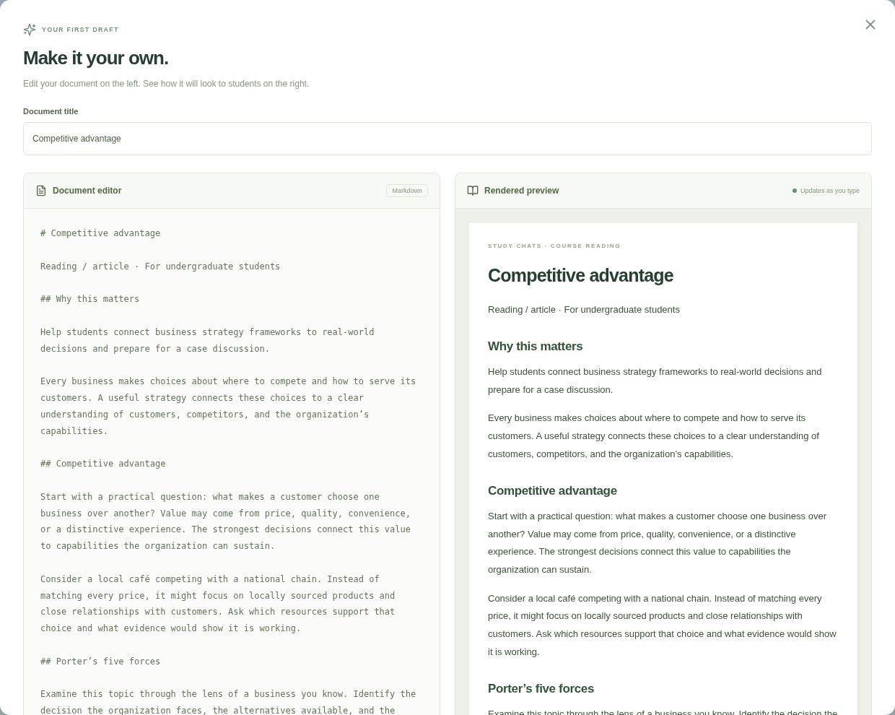

# Study Chats · Materials

Interactive instructor mockup of Study Chats embedded in Canvas, using a sample business course.

## Open the mockup

Open `study-chats.html` directly in a modern browser. No installation or server is required. Download the repository ZIP and extract it first. The HTML file contains the entire app; optional web fonts need an internet connection.

## Team preview

Open and share the live preview: https://grobergl.github.io/codex/ . GitHub Pages is enabled and deploys from the `gh-pages` branch at `/ (root)`. No download or GitHub login is required.

The `gh-pages` branch contains a self-contained `index.html` and `.nojekyll`. To update an enabled preview, regenerate `study-chats.html` with `npm run build:standalone`, copy it to `index.html` on `gh-pages`, and push that branch. The public preview uses sample content; each browser maintains its own local drafts and library changes.

## Document preview

The AI draft editor and its rendered reading are shown side by side on desktop, with a live preview as you type. On mobile, the panels stack vertically.



## Develop

```sh
npm install
npm run dev
```

Build with `npm run build`. Regenerate the single-file demo with `npm run build:standalone`. The development server uses port 5173 by default.

## Included flows

- Canvas shell with Study Chats as the course navigation item and Materials, Activity, and Results tabs.
- Course selection and simulated automatic/manual sync of pages and files, with separate libraries for two sample business courses.
- Search, source/type/date/module filters, sorting, list and grid views, and material previews.
- Create course modules directly in Materials. Assign individual materials to one or several modules, or select materials for bulk assignment. Create a module inline while assigning, clear assignments, and filter by every assigned module. Modules persist per course and are available in uploads and Activity setup. Existing browser data retains its original assignments.
- Multi-file uploads with drag-and-drop and a mirrored demo Canvas Files list.
- Five-step document wizard: purpose, topics, document format/audience/length/tone, references, and review. Fields accept typed answers and sample AI suggestions.
- Side-by-side Markdown editor and live rendered document preview on desktop; stacked panes on mobile. Headings, emphasis, links, lists, and tables render in both the draft preview and saved documents.
- Editable generated draft saved to Materials. Draft activity creation and editing link selected materials to a course module in the Activity tab.
- Results placeholder. Responsive layouts and browser-local persistence.

## Prototype boundaries

Canvas and AI integrations are simulated. Sync reads sample data and runs on course selection and app load, with a manual refresh option. No actual Canvas API, LTI installation, language model, student chat, publication, or analytics is connected. The document generator uses a template and selected source excerpts; it does not implement all format, length, or tone choices as a production model would.

Text, Markdown, and CSV uploads preserve text in local browser storage. Binary uploads retain metadata only; their original contents are not stored or downloadable. The preview download is a text representation, not the original file. Uploading mirrors entries only to the simulated Canvas Files list.

Course modules, material assignments, library metadata, text content, drafts, and activity links persist in localStorage in the current browser. They are not shared between users or devices. No live credentials are required. Instructor-only labels illustrate intended product behavior; this prototype has no authentication or authorization backend.

## Validation

Module-specific checks cover creation, duplicates, individual and bulk assignments, multiple modules per material, filters, unassignment, cancellation, reload/sync persistence, course isolation, upload/activity choices, and mobile layout. Production build and browser checks also cover search, the five-step wizard, saving drafts, uploading text files, the Files mirror, activity linking, persistence, course isolation, and mobile overflow.
